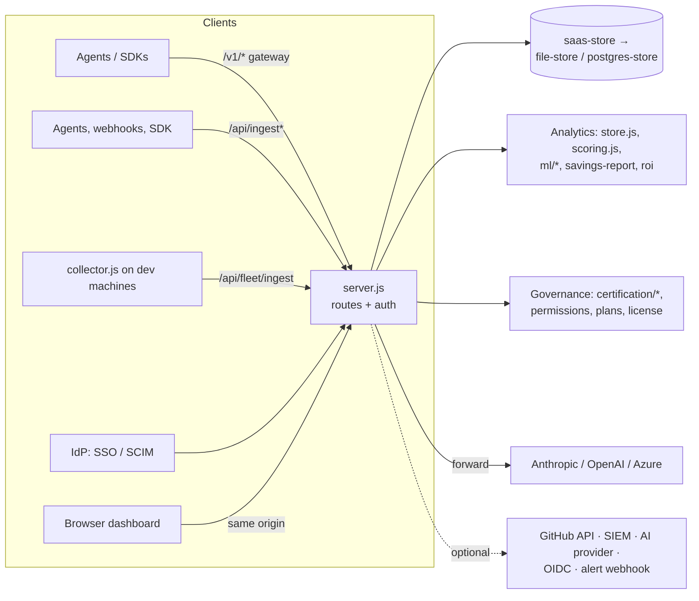

# Overall architecture and load testing

## Introduction

Agent Prism is a **single Node.js server** (ESM, raw `node:http`, no framework) that:

- takes in AI-agent telemetry in two ways:
  - the **live gateway**, which forwards agents' calls to Anthropic, OpenAI or Azure and records them;
  - **passive ingest**, where agents and webhooks report runs;
- stores it per **workspace** (tenant) in a **JSON file** or **Postgres**;
- turns it into cost, control score, cost leaks, certification, ROI, savings and Copilot views;
- serves a browser dashboard, an SPA built from static files.

It's a **modular monolith**: one process, one `server.js` with every route, and `src/` modules for each concern. `npm run cluster` runs one copy per CPU. Several replicas can share one Postgres database.

This document is the map: how the pieces fit, how a request flows, what runs in the background, how it's deployed, what state lives in memory, and what the October 2026 stress test showed. Each feature has its own design document; this one links to them.

[docs/enterprise-control-plane-architecture.md](../enterprise-control-plane-architecture.md) (24 September 2026) is a **forward plan** for wallets, budgets, policies, a seat broker, work units and a model router. **None of it is built yet.** Parts of its "current architecture" section are now out of date, for example "~4,200 lines" and "binary viewer/full-access" roles (see the end of this document).

It's a picture of the code as it is now, not of where we want it to go.

## What we have today

| Size | Today |
| --- | --- |
| `server.js` | 5,494 lines, about 110 route blocks |
| `public/app.js` | 6,522 lines (dashboard SPA) |
| `src/` | About 60 modules (59 `.js` files) |
| `db/migrations/` | 29 SQL files |
| `test/` | 51 test files (`node --test`), plus Gherkin features (`behave`) |

### Module map

| Area | Modules | Design document |
| --- | --- | --- |
| HTTP, routing, auth gates | `server.js` (`requireTenant`, `requireAdmin`, `requirePermission`, `requireBasicAuth`) | [multi-tenancy](multi-tenancy-and-api-keys.md), [auth](auth-sso-and-scim.md) |
| Middleware | `src/middleware/`: CORS, rate limiter, security headers, logger, client IP, request id, timing-safe compare, metrics | [health and resilience](health-metrics-and-resilience.md) |
| Gateway | `server.js` `/v1/*`, `src/circuit-breaker.js` | [gateway proxy](gateway-proxy.md) |
| Ingest | `src/connectors.js`, `src/ingest/verify.js`, `src/validation.js` | [passive ingest](passive-ingest.md) |
| Cost | `src/pricing.js`, `src/cost/*`, `config/pricing.json` | [cost and pricing](cost-and-pricing.md) |
| Storage | `src/saas-store.js`, `src/stores/*`, `src/db-ssl.js`, `db/` | [storage](storage-backends-and-migrations.md) |
| Analytics | `src/store.js`, `src/scoring.js` | [dashboard and analytics](dashboard-and-analytics.md) |
| ML | `src/ml/*`, `src/model-classifier.js` | [machine learning](machine-learning.md) |
| AI features | `src/llm/provider.js`, `src/ai-advisor.js` | [AI providers](ai-providers.md), [AI Advisor](ai-advisor-and-prompt-advisor.md) |
| Certification | `src/certification/*` | [agent certification](agent-certification.md) |
| ROI and savings | `src/roi.js`, `src/savings-report.js`, `src/reports/team-report.js` | [savings and ROI](savings-and-roi.md) |
| Sessions | `src/jobs/session-timeout.js` | [sessions](sessions-and-timeout.md), [cost and ROI tracker](agent-cost-roi-tracker.md) |
| Copilot | `src/copilot/*`, `src/jobs/copilot-*` | [Copilot connector](copilot-connector-and-sync.md), [copilot-roi](copilot-roi.md), [copilot-budget-breach](copilot-budget-breach.md) |
| Plans and licence | `src/plans.js`, `src/license*.js` | [licensing and plans](licensing-and-plans.md) |
| Roles | `src/permissions.js` | [auth](auth-sso-and-scim.md) |
| Encryption | `src/crypto.js`, `src/tenant-keys.js` | [encryption / BYOK](per-tenant-encryption-byok.md) |
| Audit and SIEM | stores, `src/siem-webhook.js` | [audit, GDPR and SIEM](audit-gdpr-and-siem.md) |
| Privacy | `src/privacy.js`, `src/security/outbound-url.js` | [privacy](privacy-and-data-handling.md) |
| Startup and shutdown | `src/startup.js`, `src/shutdown.js`, `src/cluster.js` | [health and resilience](health-metrics-and-resilience.md) |
| SDK and CLI | `src/sdk/index.js`, `bin/cli.js` | [SDK and CLI](node-sdk-and-cli.md) |
| Dashboard | `public/index.html`, `app.js`, `styles.css`, `dashboard.html`, `admin.html`, `leadership.html`, `storyline.html` | (per feature) |
| Fleet collector | `collector.js` | (not yet documented) |
| VS Code extension | `vscode-extension/` | (not yet documented) |

## What it does

- Keeps the whole product deployable as one container with one optional database, on any cloud, on-prem or air-gapped.
- Keeps every feature's logic in a plain module that can be tested without HTTP: scoring, ROI, savings, licence, value report.
- Swaps storage behind one interface (`saas-store`), so the file backend works for demos and Postgres for production.

## Where the data comes from

| Input | Entry point |
| --- | --- |
| Agents' model calls | `/v1/messages`, `/v1/responses`, `/v1/chat/completions`, `/v1/azure/*` |
| Reported runs | `/api/ingest`, `/api/ingest/{claude,copilot,generic}` |
| Coding-assistant usage | `/api/fleet/ingest` (collector), Live Sessions (local scan) |
| Sessions and usage | `/api/sessions`, `/api/usage` |
| Copilot | GitHub API (lazy sync) |
| People | Sign-in, SSO, SCIM, invites |
| Settings | Environment variables, `config/pricing.json`, licence |

## How it works

### 1. One request

1. `createServer` handler: count in-flight, set `Connection: close` if draining, attach `X-Request-ID`, register the finish hook (log line and metrics).
2. CORS (preflight answered here).
3. Route matching: a long `if`/`else if` chain on `req.method` and `req.url`, roughly grouped as health, auth, SSO, users, SCIM, admin, OAuth, gateway, dashboard and analytics, ML, advisor, connectors, Copilot, ingest, sessions and metrics, reports, certification, static pages.
4. In the matched route:
   - `requireTenant`: JWT → API key → dashboard session (plus a CSRF check), read-only check, IP allowlist, rate limit;
   - then `requirePermission`, plan checks, validation and the store calls;
   - then the response.
5. Static files and the SPA are served last, with a CSP nonce for HTML.
6. A global `catch` turns bad input (bad escapes, Postgres format errors) into `400`, database connection failures into `503` with `Retry-After`, and anything else into `500`.

### 2. Write paths

There are two paths into `upsertTenantRuns`, sharing no code:

- **Gateway:** auth → plan and gateway checks → budget → token-rate limit → circuit breaker → provider → cost → save the run. No certification gate.
- **Ingest:** auth → signature (where used) → normaliser → idempotency → plan → certification gate → save → auto-revoke. On a save error, the run goes to the retry queue.

Both feed `buildDashboardSnapshot` on the next `/api/dashboard` request.

### 3. Background work

Timers run in **every process**. There's no external scheduler.

| Job | How often | Backend |
| --- | --- | --- |
| Data retention | At startup, then daily | Both |
| Savings baselines | Hourly | Postgres |
| Load ML models and fit the detector | 5 s after startup | Postgres |
| Rebuild the detector | Hourly | Postgres |
| Failed-ingest retry | Every 5 min (20 at a time) | Both |
| Idempotency key cleanup | Hourly (older than 24 h) | Both |
| Rate-limiter cleanup | Every 60 s | Both |
| Session timeout, Copilot syncs, file-store ML fit | **When a request needs them** | Both |
| Database preparation (migrations, schema patches under an advisory lock) | At startup | Postgres |

### 4. What lives in memory (per process)

| State | Effect with several processes |
| --- | --- |
| Dashboard cache (5 s) | Each process builds its own |
| Rate limiters (workspace, key requests, key tokens, sign-in, bootstrap, admin failures) | Limits multiply by the number of processes |
| Circuit breakers | Each process opens and closes separately |
| ML models (value model, detector) | Retraining reaches one process only |
| `/api/leaks` "already alerted" memory | Depends on which process answers |
| SSO pending sign-ins | Callback can fail on another process |
| BYOK unsealed keys | Must be unsealed in each process |
| LLM classifier cache, metrics counters | Per process |

### 5. Deployment

| Target | How |
| --- | --- |
| Docker | `Dockerfile`: `node:24-alpine`, non-root user, `npm ci --omit=dev`, copies `server.js`, `src/`, `config/`, `public/`, `db/`, port 3000, `HEALTHCHECK` on `/api/health/live`, `CMD node server.js` (single process) |
| Compose | `docker-compose.yml`: `app` plus `postgres` (not published, password from `.env`, health checks) |
| Render (hosted demo) | `render.yaml`: Docker, `NODE_ENV=production`, `TRUST_PROXY=true`, health check on liveness |
| Cluster | `npm run cluster` (Postgres only for more than one worker) |
| Not in the image | `scripts/` (including the owner console and signing tools), `collector.js`, `bin/`, `vscode-extension/`, tests |

### 6. Load testing (October 2026)

From [docs/STRESS-TEST.md](../STRESS-TEST.md). The setup was one process on an 8-core laptop with production mode and local Postgres 18, using `scripts/stress/load.mjs` (load) and `scripts/stress/fuzz.mjs` (every route with malformed input). It also covered failure injection (Postgres killed, connections terminated, SIGTERM under load, four servers starting at once) and a 2-minute soak.

| Measure | After the fixes |
| --- | --- |
| Ingest, 50 workers | About 3,000 req/s, flat from 37k to 450k rows; p50 15 ms / p99 28 ms |
| Dashboard, 10–20 users | 664 req/s, p50 22 ms; 186 KB response |
| Malformed requests returning 500 | 0 of 3,032 |
| Database outage | 503 + `Retry-After`, recovers by itself |
| File backend, 400 concurrent writes | 400 of 400 stored |
| Memory over the soak | Flat, 170–185 MB |

27 problems were found and fixed, 4 of them critical. These were: a cross-tenant run takeover through reused run ids, a crash on any database interruption, ingest slowing as history grew, and the file backend losing concurrent writes. Regression tests are in `test/hardening.test.js` and `test/postgres.integration.test.js`. Before each release, re-run against staging: `node scripts/stress/load.mjs mixed 50 60` and `node scripts/stress/fuzz.mjs`.

## API

About 110 routes. The groups are listed in `CLAUDE.md` (API surface) and in each feature's document. For the full list: `grep -nE 'req\.method === "(GET|POST|PUT|PATCH|DELETE)" && req\.url' server.js`.

## Dashboard / UI

There's one SPA (`index.html` + `app.js`, about 25 requests per load) with Overview, Token Coach, Activity, Governance, Certification, Reports and Admin. Older and secondary pages (`/dashboard`, `admin.html`, `leadership.html`, `storyline.html`) are served from `public/`; `/setup` serves the main SPA page again.

## Changes by file

The files that hold the architecture together:

| File | Role |
| --- | --- |
| `server.js` | Entry point, every route, background timers |
| `src/saas-store.js`, `src/stores/*` | Storage interface and backends |
| `src/cluster.js`, `src/startup.js`, `src/shutdown.js` | Process lifecycle |
| `Dockerfile`, `docker-compose.yml`, `render.yaml` | Deployment |
| `scripts/stress/*` | Load and fuzz testing |
| `CLAUDE.md`, `DEVELOPER.md`, `README.md` | Developer orientation |

## Tests

- `npm test`: every `test/*.test.js` (284 passing at the stress test; 6 Postgres tests skipped without a database).
- `npm run test:postgres`: needs `TEST_DATABASE_URL`.
- `npm run test:bdd`: Gherkin scenarios via `behave`.
- `scripts/stress/load.mjs`, `fuzz.mjs`: run by hand before a release; not in CI.

## Known limitations

Weak spots in the current design:

1. **One 5,500-line file holds every route.** Routes are an ordered `if`/`else` chain, so order matters: `/api/agents/certifications` must come before `/api/agents/:name`. Shared steps such as auth, plan checks and audit are repeated by hand in each route. Getting the order or the copy-paste wrong is a recurring source of bugs (for example, the gateway paths that miss the budget check).
2. **Scaling out multiplies state that should be shared.** Everything in section 4 lives in each process. With several processes or replicas, rate limits multiply, circuits and ML models drift apart, SSO sign-ins and BYOK unseals break, and `/api/leaks` gives different answers. There's no shared cache (such as Redis).
3. **Background jobs run in every replica.** Retention, baselines, the detector rebuild, the failed-ingest retry and idempotency cleanup all run on each process, with nothing stopping two at once. The failed-ingest retry could process the same item twice.
4. **Two storage backends to keep in step.** Every store function exists twice (file and Postgres) with small behaviour differences, several of which are noted in the feature documents (agent definitions, ML weights, baselines, audit log size).
5. **No API versioning or schema.** No OpenAPI document, no `/v1` for the dashboard API, and validation schemas cover only some routes.
6. **Load numbers are from one laptop process.** The gateway wasn't load-tested against real providers, and circuit breakers weren't tried in a real outage. The stress scripts aren't part of CI.
7. **The SPA is one 6,500-line file**, built from HTML strings. Escaping is done by hand in each place (see the HTML-escaping work on the current branch, and the unescaped prompt in the Prompt Advisor).
8. **The forward architecture plan is partly out of date.** `docs/enterprise-control-plane-architecture.md` describes roles as "binary viewer/full-access" (there are now four roles with a permission table) and `server.js` as about 4,200 lines (now 5,494). It should be marked clearly as a plan, so nobody reads it as how the product works today.
